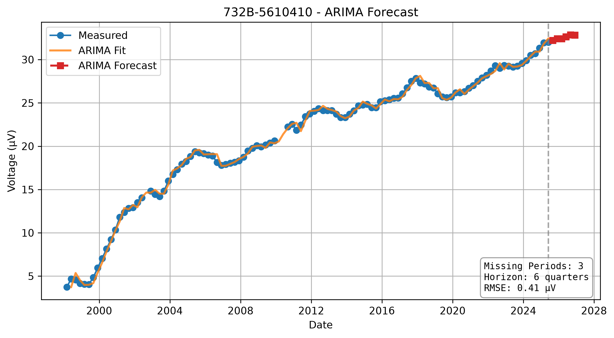
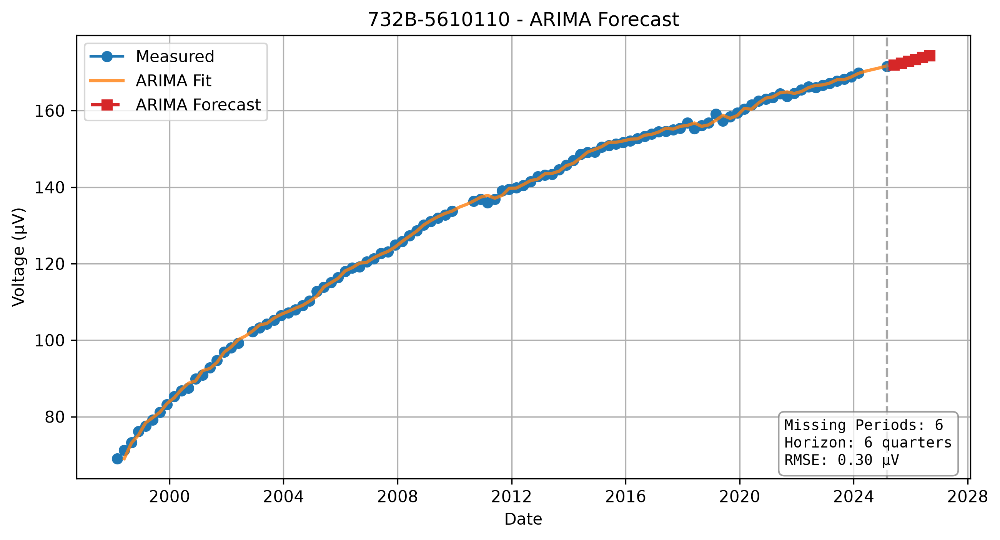
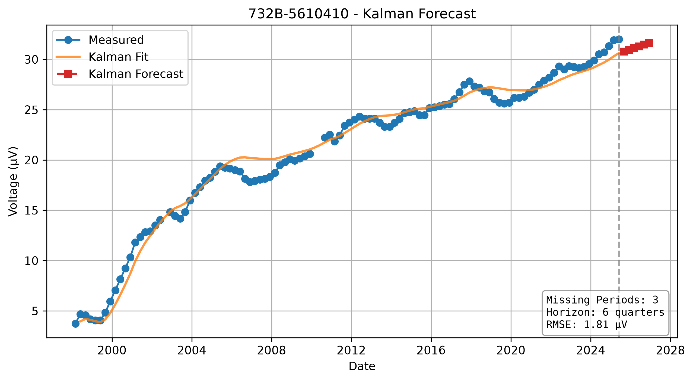
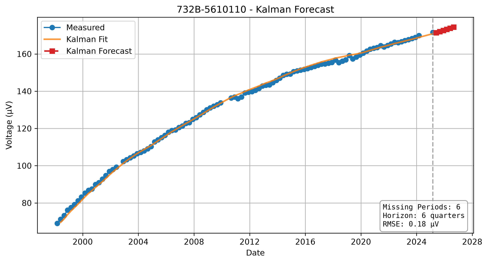

# ZenerEstimation

A modular framework for battery degradation analysis, forecasting, visualization, and experiment management.


## Documentation

- `docs/ARCHITECTURE.md` — Framework architecture
- `docs/DEVELOPMENT_HISTORY.md` — Sprint-by-sprint project evolution
- `docs/RELEASE_NOTES.md` — Version history


```markdown
## Forecast Examples

### ARIMA

| 732B-5610410 | 732B-5610110 |
|---|---|
|  |  |

### Kalman

| 732B-5610410 | 732B-5610110 |
|---|---|
|  |  |


## Cross-Battery Scientific Dashboard

The cross-battery dashboard provides comparative analysis and visualization for two battery datasets:

- **732B-5610410 (410):** Optimized six-model benchmark.
- **732B-5610110 (110):** Transferred six-model benchmark using configurations selected for battery 410, rather than independently optimized configurations for battery 110.

### Installation

Install the package with its optional dashboard dependencies:

```powershell
python -m pip install -e ".[dashboard]"
```

### Launch

From the repository root:

```powershell
python -m streamlit run examples/dashboard/cross_battery_dashboard.py
```

### Required Scientific Artifacts

The dashboard requires locally available benchmark evidence in the following directories:

```text
results/732B-5610410/optimized_benchmark/
results/732B-5610110/transferred_benchmark/
```

These benchmark artifacts are preserved separately from the source-code release and are not automatically installed with the Python package.

Before launching the dashboard in a new environment, restore the required artifacts from the approved archive and verify their integrity against the corresponding SHA-256 manifest.

### Scientific Interpretation

- Cross-battery comparisons distinguish optimized and transferred model configurations.
- Illustrative Remaining Useful Life (RUL) thresholds are not engineering-validated failure limits.
- Forecast dispersion represents disagreement among models, not a calibrated confidence interval.
- Forecast threshold crossings are model-dependent extrapolations, not validated failure probabilities.
- A model that does not cross the threshold within the forecast horizon is right-censored; this does not establish infinite remaining useful life.
- The dashboard reads previously generated evidence and does not retrain or reoptimize forecasting models.

The dashboard is intended for scientific comparison and diagnostic interpretation, not validated operational failure prediction.


The results/ directory is created automatically by demonstrations and stores generated experiment artifacts. It is excluded from version control.